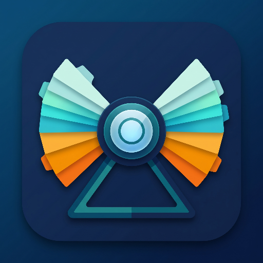

# Rolodex



An always-on overlay quick launcher. A single thin, faint pill sits on one screen
edge (left or right, configurable, with adjustable width and height). Swipe it —
or just tap it — to expand a semi-transparent search panel out of that edge over
the current app. The search field takes focus and the keyboard opens automatically.

Type to get, in one scrollable list:

- **Apps** — installed apps matching your text (exact and prefix matches first),
  tap to launch. The list scrolls through all matches. Launch mode is configurable:
  full screen, split view, or floating window (device-dependent).
- **Offline dictionary** — the full Princeton WordNet® 3.0 (147,306 words), no network needed.
  Definitions get a tall, multi-line row.
- **Calculator** — e.g. `2+2`, `(12*3)/4`, `2^10`, `sqrt(9)`, `pi*2`. Tap to copy.
- **Unit conversions** — e.g. `10 km to mi`, `100 f to c`, `5 kg in lb`, `60 mph to kph`. Tap to copy.
- **Exchange rates** — e.g. `100 usd to eur`, `50 eur in gbp`, `$100 to jpy`. Tap to copy.
  Rates refresh from [open.er-api.com](https://open.er-api.com) at most every 6 hours;
  a bundled snapshot of 166 currencies is used offline.
- **Web search** — always available; opens the query in your default browser.

The results list scrolls and stays above the on-screen keyboard when it is open.
A soft black dim layer fades in behind the panel while it is open, and fades out
as it collapses. The panel collapses back into the pill when you pick a result or
dismiss it (tap outside, or press Back).

## Build

```sh
./gradlew assembleDebug
```

Debug APK: `app/build/outputs/apk/debug/app-debug.apk`

## Device test

1. Install: `adb install -r app/build/outputs/apk/debug/app-debug.apk`
   (or sideload the APK).
2. Open Rolodex. If prompted, allow the notification permission.
3. Choose **Trigger side**, use the **Trigger width** / **Trigger height**
   sliders to make the pill comfortable for your finger, and pick **Open apps in**
   (full screen / split / floating). Changes apply immediately.
4. Tap **1. Grant overlay permission** and enable "Display over other apps"
   for Rolodex, then come back.
5. Tap **Start Rolodex**. A persistent notification confirms the service is up.
6. Leave the app, swipe the edge pill, and try `hello`, `2+2`, and `10 km to mi`.
7. Return to Rolodex to change the trigger size/side or stop the service.

## Data attribution

The offline dictionary (`app/src/main/assets/words.txt`) is built from the
Princeton WordNet® 3.0 database (WNdb-3.0). WordNet 3.0 is Copyright 2006 by
Princeton University and is used under its license, bundled as
`app/src/main/assets/WORDNET_LICENSE.txt`. The license notice is also shown in
the app.

Notes:
- Requires Android 8.0 (API 26) or newer.
- Battery optimizers on some OEM skins may kill a foreground service; if the
  pill disappears, reopen Rolodex and start it again.
